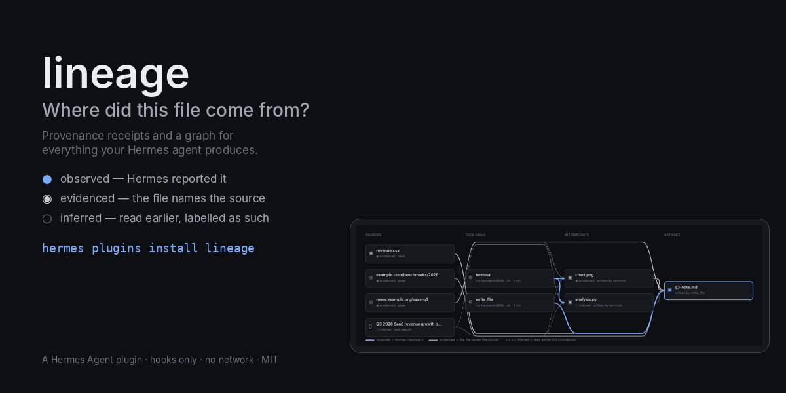
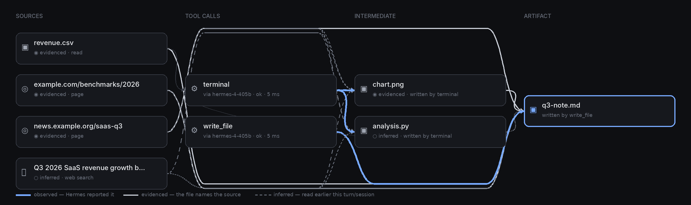

<p align="center">
  
</p>

<p align="center">
  <a href="https://github.com/NousResearch/hermes-agent/blob/main/plugin-catalog/lineage.yaml"></a>
  
  
  <a href="https://github.com/P0GL0L/hermes-lineage/actions"></a>
  <a href="LICENSE"></a>
</p>

<h3 align="center">Your agent just handed you a report.<br>Where did that number come from?</h3>

<p align="center">
<b>lineage</b> gives every file your Hermes agent writes a receipt — the pages it fetched, the files it read, the script it ran, the model that issued the call, the agent that did the work, all with SHA-256 hashes — and draws the graph from the file back to its sources.
</p>

```
hermes plugins install lineage
hermes plugins enable lineage
```

<p align="center"><sub>Listed in the <a href="https://github.com/NousResearch/hermes-agent/blob/main/plugin-catalog/lineage.yaml">official Hermes plugin catalog</a>, reviewed and merged by Nous Research (<a href="https://github.com/NousResearch/hermes-agent/pull/149244">#149244</a>).</sub></p>

---

## Sixty seconds

Ask Hermes for something that touches the world:

> Read `revenue.csv`, fetch https://hermes-agent.nousresearch.com/docs/, then write `q3-note.md` with three bullets that cite the CSV figures and that URL.

Then ask where it came from:

```
$ hermes lineage show q3-note.md
q3-note.md  (d41d886bb02e…, 395 bytes)
  written by write_file at 2026-11-05T03:04:08Z
  by main (grok-4.7)
  model call grok-4.7
  asked: “Read revenue.csv, fetch https://hermes-agent.nousresearch.com/docs/ with web_extract, then write q3-note.md…”
  from 2 source(s):
    ◉ evidenced file  revenue.csv   path appears in artifact
    ◉ evidenced url   https://hermes-agent.nousresearch.com/docs   url appears in artifact
  ● observed  ◉ evidenced  ○ inferred
```

Write the receipt next to the file, and check it with no database and no Hermes at all:

```
$ hermes lineage receipt q3-note.md --write
wrote q3-note.md.receipt.json

$ hermes lineage check q3-note.md.receipt.json
{ "ok": true, "artifact_sha256_matches": true, "receipt_sha256_matches": true, "signature": "valid", "sources": 2 }
```

Change the CSV under it, and the note goes stale:

```
$ echo 'Q4,21' >> revenue.csv && hermes lineage verify q3-note.md
q3-note.md: unchanged  → verdict: stale
  changed     evidenced  revenue.csv
  unchecked   evidenced  https://hermes-agent.nousresearch.com/docs
```

That transcript is from a real run on Hermes Agent 0.22.7, not a mock-up. In chat, the same things are `/lineage`, `/lineage q3-note.md`, `/lineage receipt …`, `/lineage verify …`.

---

## The graph

<p align="center"></p>

Open **Lineage** in the Hermes Desktop sidebar (or click the `N artifacts` chip in the status bar). Sources on the left, the tool calls that read and wrote them in the middle — each annotated with the model call that issued it — intermediate files next, and the artifact you asked about on the right. Click anything:

- a **URL** shows the content hash at fetch time and which tool read it
- a **tool call** shows its redacted, bounded arguments and what it wrote
- the **artifact** shows its hash and versions, with **Verify**, **Verify + refetch URLs**, **Write receipt**, **Copy Mermaid** and **Reveal** one click away

The page refreshes while the agent works.

## Three kinds of link, never blended

The honest part. Most provenance tooling draws one arrow and calls it "derived from". lineage keeps three, labels each, and writes the label into the receipt so a reader can discount the weak ones.

| | basis | what it means | drawn as |
|---|---|---|---|
| ● | **observed** | Hermes reported it: `write_file` wrote this path; this tool call came out of that model request; this child agent was spawned by that turn. | thick accent line |
| ◉ | **evidenced** | The artifact's own bytes name the source — a URL that was fetched this session, or the path of a file that was read. | solid line |
| ○ | **inferred** | The source was read earlier in the same turn (confidence 0.6) or in a recent turn of the session (0.35). A dashed edge says *read earlier*, not *used*. | dashed line |

## The receipt

`<file>.receipt.json` sits beside the file, on request or automatically with `sidecar: true`. Trimmed from the run above:

```json
{
  "schema": "lineage.receipt.v1",
  "artifact": { "name": "q3-note.md", "sha256": "d41d886b…", "size": 395, "versions": [ … ], "cited_in_final_reply": true },
  "produced_by": { "tool": "write_file", "tool_call_id": "call-99df…-4", "at": "2026-11-05T03:04:08Z", "duration_ms": 23 },
  "agent": { "chain": [ { "role": "main", "model": "grok-4.7", "platform": "cli" } ] },
  "turn": { "user_prompt_preview": "Read revenue.csv, fetch https://…", "user_prompt_sha256": "5b7e2ce6…" },
  "models": [ { "model": "grok-4.7", "usage": { "input_tokens": 27241, "output_tokens": 472, "reasoning_tokens": 290 } } ],
  "sources": [
    { "kind": "file", "locator": "/…/revenue.csv", "sha256": "75e92e4b…", "basis": "evidenced", "confidence": 0.9,
      "reason": "path appears in artifact", "read_by": { "tool": "read_file", "at": "2026-11-05T03:04:00Z" } },
    { "kind": "url",  "locator": "https://hermes-agent.nousresearch.com/docs", "basis": "evidenced", "confidence": 0.9,
      "reason": "url appears in artifact", "read_by": { "tool": "terminal" } }
  ],
  "transformations": [ { "tool": "web_extract", "status": "error" }, { "tool": "read_file" }, { "tool": "terminal" }, { "tool": "write_file", "wrote_this": true } ],
  "integrity": { "receipt_sha256": "…", "signature": { "alg": "HMAC-SHA256", "key_id": "…" } }
}
```

Notice `web_extract … "status": "error"` followed by `terminal`: the fetch tool failed, the model fetched the page from the shell instead, and lineage still caught the URL as a source — from the command text. The receipt records what happened, not what was supposed to happen.

The signature is from a per-install random key. It lets *this install* recognise receipts it issued; it is not a third-party attestation, and the receipt says so.

## Verify, and staleness

```
hermes lineage verify q3-note.md               # the file and its file sources against recorded hashes
hermes lineage verify q3-note.md --refetch     # also re-fetch URL sources — the only network lineage ever does; public hosts only, every redirect hop checked
```

| verdict | meaning |
|---|---|
| **fresh** | nothing moved |
| **stale** | a source changed since the artifact was made |
| **modified** | the artifact itself changed |
| **missing** | the artifact is gone |

The Desktop list marks every artifact with its last verdict. URL change detection is honest about its limits: the hash recorded at fetch time is of the *extracted* text, which a raw re-fetch cannot reproduce, so the first `--refetch` sets a baseline fingerprint and later runs report *unchanged since* / *changed since* that date.

## Everything you can ask

| in chat | on the command line | what you get |
|---|---|---|
| `/lineage` | `hermes lineage list` | artifacts made in this session, with source counts and verdicts |
| `/lineage <file>` | `hermes lineage show <file>` | the plain-text account above; `--json` for the full receipt |
| `/lineage receipt <file>` | `hermes lineage receipt <file> --write` | `<file>.receipt.json` beside the file |
| `/lineage verify <file>` | `hermes lineage verify <file> [--refetch]` | fresh / stale / modified / missing |
| | `hermes lineage check <file>.receipt.json` | verify a receipt with no database |
| `/lineage mermaid <file>` | `hermes lineage graph <file> [--format mermaid\|dot\|json]` | the graph, ready for a diagram tool |
| `/lineage stats` | `hermes lineage stats` · `sessions` · `prune --days 90 --yes` | what the store holds; housekeeping |

## What it will not do

Said plainly, because the receipts are only worth something if their limits are.

- lineage sees what Hermes's hooks report. A file written by a background process that outlives the tool call, or by anything outside Hermes, is not attributed.
- *Inferred* means inferred. The `basis` and `confidence` fields exist so you can ignore the dashed lines.
- Working trees over `snapshot_max_files` (6000) or slower than half a second to walk are not scanned after terminal calls; `write_file`/`patch` attribution still works there. A file another process modifies during a terminal call's window can be attributed to that call.
- URL hashes are of Hermes's extracted text; raw re-fetches establish their own baseline.
- The signature proves which install issued a receipt, nothing more.
- Under `plugins.isolation: host`, the Desktop backend and `/lineage` still work but `hermes lineage …` is not wired (Hermes does not route CLI subcommands into the host).

## Configuration

Defaults are sensible; nothing is required. `~/.hermes/config.yaml`:

```yaml
plugins:
  enabled: [lineage]
  entries:
    lineage:
      settings:
        sidecar: false             # write <file>.receipt.json beside every artifact when its turn ends
        store_previews: true       # short redacted previews of prompts, args and results (false = ids and hashes only)
        track_aux_calls: true      # record compression / title / vision model calls as nodes in the turn
        snapshot_max_files: 6000   # largest working tree scanned after a terminal / execute_code call
        max_artifacts_per_call: 50 # most files attributed to one tool call
        session_window_turns: 3    # earlier turns that count as inferred sources (0 disables)
```

## How it works, briefly

Ten observer hooks → a SQLite graph at `<HERMES_HOME>/plugin-data/lineage/lineage.db` → receipts and the page. `write_file` and `patch` (including V4A multi-file patches) are observed directly; `terminal` and `execute_code` get one bounded walk of the working tree after the call, attributing every file whose mtime falls inside the call's window; `read_file`, `web_search`, `web_extract`, `skill_view`, and paths or URLs named in commands and arguments become sources; when an artifact lands, its text is scanned for the session's sources (evidenced), then the turn's reads (inferred 0.6) and the last three turns' (0.35). `api_request_id` on each tool call links it to the model request that issued it; `subagent_start/stop` carry the agent chain.

Everything stored is bounded and redacted before it reaches disk — vendor key prefixes, `token=`, `Bearer …`, PEM blocks, `FOO_KEY=…` in shell text, `user:pass@` and credential-shaped query values in URLs. A blocked or failed tool call records nothing.

lineage registers **no `pre_tool_call`**. Hermes treats that hook as fail-closed — a slow callback blocks the agent's tool call — and an observer must never be able to do that. Every callback also swallows its own errors: a provenance recorder that can interrupt the agent is worse than no recorder.

The full account — every node kind, edge rule, bound and redaction — is in **[docs/how-it-works.md](docs/how-it-works.md)**.

## Disclosure

Hooks only (`post_tool_call`, `pre_llm_call`, `post_llm_call`, `post_api_request`, `api_request_error`, `post_auxiliary_call`, `subagent_start`, `subagent_stop`, `on_session_start`, `on_session_end`); no tools, no middleware, no LLM calls, no credentials. Runs no commands. Hashes files the agent read or wrote (up to 32 MB), scans the text of files it wrote for sources (up to 512 KB) and stats the working tree once after `terminal`/`execute_code` calls (bounded by file count and time). Receipts and verify apply only to files the agent produced, never to files it only read. Writes only under `<HERMES_HOME>/plugin-data/lineage/` (SQLite store, `install.key`) and, on request or with `sidecar: true`, `<file>.receipt.json` beside artifacts. Stores redacted, bounded previews of prompts, tool arguments and results (`store_previews: false` turns previews off). Network only when you run `verify --refetch` or press *Verify + refetch URLs*, and then only `GET` to the recorded source URLs on public hosts (loopback, private and link-local addresses are refused, through Hermes's own `is_safe_url` when available; redirects are followed only to hosts that pass the same check, at most 5 hops). No telemetry.

## Validated

- **Catalog review.** Nous Research reviewed the entry and its disclosure and merged it into the official catalog ([#149244](https://github.com/NousResearch/hermes-agent/pull/149244)). The review's wording surfaced that `verify --refetch` followed redirects with only the first URL checked; 0.1.5 checks every hop.
- **On a real install.** `hermes plugins validate` on Hermes Agent v0.22.7 (macOS): every check passes — manifest, `requires_hermes`, config schema, loadable, capability probe, declared tools/hooks/middleware, built-in collisions, security scan *safe*, no core override, desktop surface inside the SDK. The transcript in *Sixty seconds* is from a live task on that install, and the Desktop page was driven end to end there while recording the demo — which is how the 0.1.4 staleness bug was found.
- **In CI, on every push.** Python 3.11–3.13, the Desktop half under jsdom, and the catalog's own admission check (`hermes plugins validate`) against current Hermes main.
- **Reviewed.** An independent review against the Hermes source found eight defects before the first release (including the `pre_tool_call` risk and secret-bearing URL ids); all are fixed and covered by tests. Every bug found since ships with a test that fails on the old code.

## Development

```
python -m pytest -q tests                 # 17 tests: tracker, receipts, redaction, CLI, slash command, API, review regressions
cd tests-js && npm install && npm test    # Desktop half under jsdom, against fixtures generated by the Python core
hermes plugins validate .                 # the catalog admission checks
```

Develop the Desktop half live: `ln -s $(pwd) ~/.hermes/plugins/lineage`, enable it, and every save of `desktop/plugin.js` hot-reloads. The graph picture above is rendered from the same test fixture by `docs/render.py`.

## License

MIT — Charles Bonetti / [ASV Labs](https://asv-labs.com). Built for the Hermes Agent Plugin Hackathon, November 2026.
