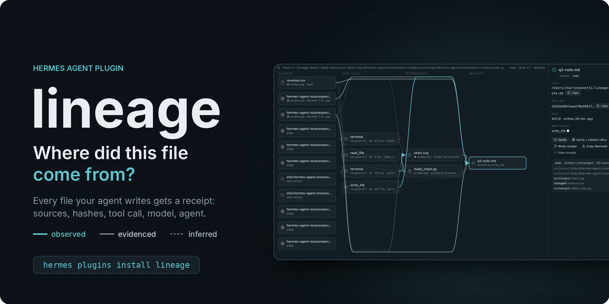
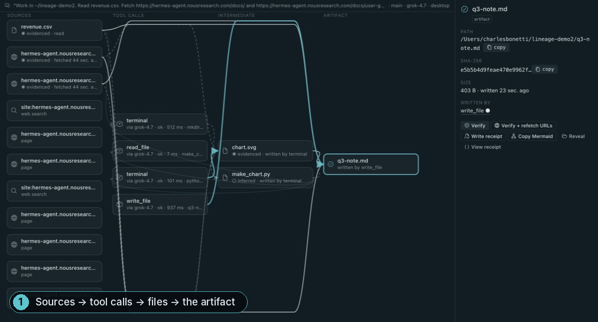
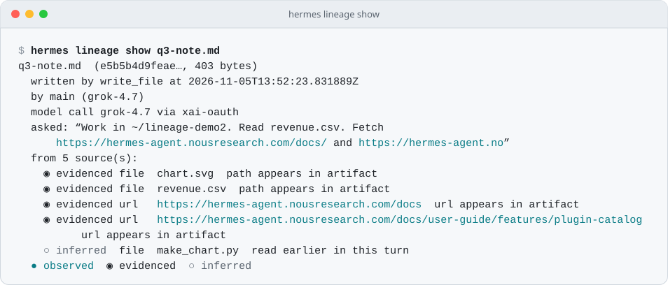
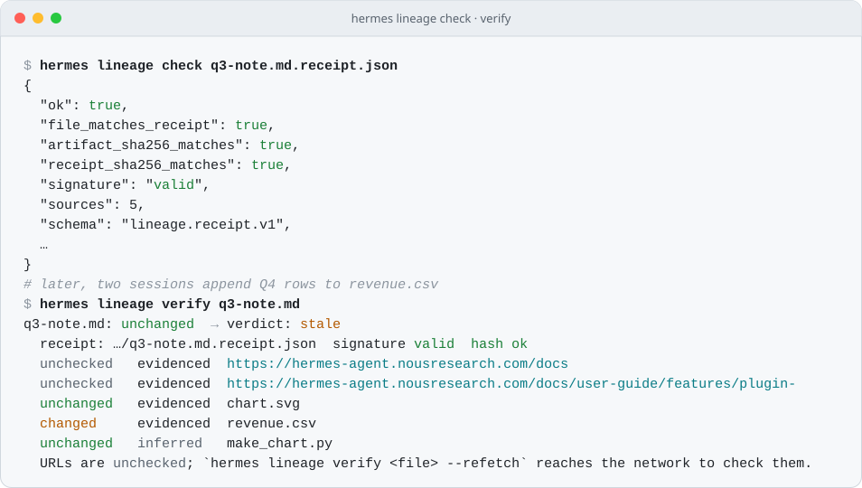
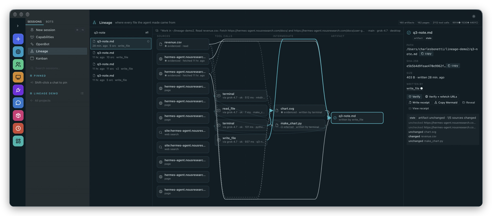
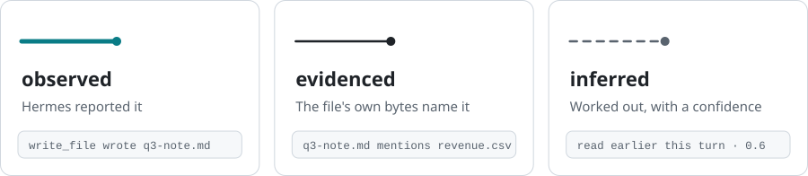
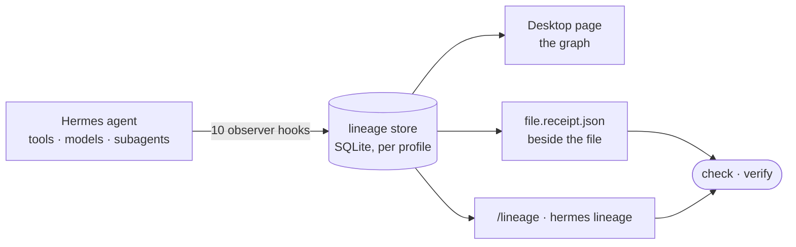

<p align="center">
  
</p>

<p align="center">
  <a href="https://github.com/NousResearch/hermes-agent/blob/main/plugin-catalog/lineage.yaml"></a>
  <a href="https://github.com/P0GL0L/hermes-lineage/releases/latest"></a>
  <a href="https://github.com/P0GL0L/hermes-lineage/actions/workflows/ci.yml"></a>
  
  
  <a href="LICENSE"></a>
</p>

<h3 align="center">Your agent just handed you a report.<br>Where did that number come from?</h3>

<p align="center">
  <b>lineage</b> gives every file your Hermes agent writes a signed receipt — the pages it fetched, the files it read, the script it ran, the model that issued the call, the agent that did the work, all with SHA-256 hashes — and draws the graph from the file back to its sources.
</p>

```bash
hermes plugins install lineage && hermes plugins enable lineage
```

> [!TIP]
> **In the official Hermes plugin catalog.** Reviewed and merged by Nous Research in [#149244](https://github.com/NousResearch/hermes-agent/pull/149244). Open **Lineage** in the Hermes Desktop sidebar, or type `/lineage` in any chat.

<p align="center">
  
</p>
<p align="center"><sub>Real Hermes Desktop, real run, no mock-ups. The full 85-second demo is <a href="#watch-it">below</a>.</sub></p>

<br>

## What you get

<table>
  <tr>
    <td width="33%" valign="top">
      <picture><source media="(prefers-color-scheme: dark)" srcset="docs/media/icon-receipt-dark.svg"></picture>
      <p><b>Receipts that travel</b></p>
      A signed <code>.receipt.json</code> beside the file: sources, hashes, tool call, model and agent chain. Checkable without the database.
    </td>
    <td width="33%" valign="top">
      <picture><source media="(prefers-color-scheme: dark)" srcset="docs/media/icon-graph-dark.svg"></picture>
      <p><b>A graph you can click</b></p>
      A Hermes Desktop page from sources to tool calls to files to the artifact. Every node opens its hashes, arguments and timing.
    </td>
    <td width="33%" valign="top">
      <picture><source media="(prefers-color-scheme: dark)" srcset="docs/media/icon-verify-dark.svg"></picture>
      <p><b>Stale-report alarm</b></p>
      Verify re-hashes the file and every source. When the data under a report moves, it says <b>stale</b> and names the source.
    </td>
  </tr>
  <tr>
    <td width="33%" valign="top">
      <picture><source media="(prefers-color-scheme: dark)" srcset="docs/media/icon-bases-dark.svg"></picture>
      <p><b>Honest edges</b></p>
      Observed, evidenced or inferred — labelled, never blended. Anything lineage worked out carries a confidence.
    </td>
    <td width="33%" valign="top">
      <picture><source media="(prefers-color-scheme: dark)" srcset="docs/media/icon-hook-dark.svg"></picture>
      <p><b>Never in the agent's way</b></p>
      Ten observer hooks. No tools, no middleware, no <code>pre_tool_call</code>: it cannot block or slow a tool call.
    </td>
    <td width="33%" valign="top">
      <picture><source media="(prefers-color-scheme: dark)" srcset="docs/media/icon-lock-dark.svg"></picture>
      <p><b>Redacted before disk</b></p>
      Keys, tokens, signed URLs and DSN passwords are masked before anything is stored. Network only when you ask.
    </td>
  </tr>
</table>

<br>

## Sixty seconds

Ask Hermes for something that touches the world:

> *Work in ~/lineage-demo2. Read revenue.csv. Fetch https://hermes-agent.nousresearch.com/docs/ and …/plugin-catalog with web_extract. Run python3 make_chart.py. Then write q3-note.md: three bullets on Q3 revenue citing the CSV figures and both URLs, and embed chart.svg.*

Then ask where the note came from:

<picture>
  <source media="(prefers-color-scheme: dark)" srcset="docs/media/term-show-dark.svg">
  
</picture>

Check the receipt beside it, then watch the note go stale when the data under it moves:

<picture>
  <source media="(prefers-color-scheme: dark)" srcset="docs/media/term-check-dark.svg">
  
</picture>

<details>
<summary><b>Copy the commands</b></summary>

```bash
hermes lineage show q3-note.md                 # where it came from, in plain text (--json for the receipt)
hermes lineage receipt q3-note.md --write      # q3-note.md.receipt.json beside the file
hermes lineage check q3-note.md.receipt.json   # file + receipt, no database needed
hermes lineage verify q3-note.md               # fresh / stale / modified / missing
```

</details>

Every line above is real output from Hermes Agent 0.22.7 on macOS running lineage 0.1.5. In chat, the same things are `/lineage`, `/lineage q3-note.md`, `/lineage receipt …` and `/lineage verify …`.

<br>

## The graph

<p align="center">
  
</p>

Open **Lineage** in the Hermes Desktop sidebar, or click the `N artifacts` chip in the status bar. Sources sit on the left. The tool calls that read and wrote them are in the middle, each tagged with the model call that issued it. Intermediate files come next, and the artifact you asked about is on the right. Click anything:

- **a page** shows its URL, the content hash at fetch time, and the search that found it
- **a tool call** shows its redacted, bounded arguments, its duration, and what it wrote
- **the artifact** shows its hash and versions, with **Verify**, **Verify + refetch URLs**, **Write receipt**, **Copy Mermaid** and **Reveal** one click away

The graph is drawn as of the moment each source fed the artifact. A file rewritten later still appears as it was then. The page refreshes while the agent works.

<br>

## Three kinds of link, never blended

<picture>
  <source media="(prefers-color-scheme: dark)" srcset="docs/media/bases-dark.svg">
  
</picture>

Most provenance tooling draws one arrow and calls it "derived from". lineage keeps three kinds of link, labels each one, and writes the label into the receipt, so a reader can discount the weak ones.

<details>
<summary><b>Where each kind comes from</b></summary>

| basis | confidence | how it arises |
|---|---|---|
| **observed** | 1.0 | Hermes reported it: `write_file`/`patch` wrote this path, `read_file`/`web_extract` read that one, this tool call came out of that model request, this subagent was spawned by that turn |
| **evidenced** | 0.9 | the artifact's own bytes name the source: a fetched URL or a read file's path appears in the text |
| **inferred** | 0.8 | a file changed in the working tree during a `terminal` / `execute_code` call |
| | 0.9 | same bytes as an artifact that was moved or copied |
| | 0.6 / 0.35 | read earlier in this turn / in a recent turn |
| | 0.5 | a file or URL named in a shell command |

</details>

<br>

## Verify, and staleness

| verdict | meaning |
|:--|:--|
| 🟢 **fresh** | nothing moved |
| 🟠 **stale** | a source changed, or is gone, since the artifact was made |
| 🔴 **modified** | the artifact itself changed after it was written |
| ⚫ **missing** | the artifact is gone |

```bash
# the file and its file sources, against the hashes recorded when it was built
hermes lineage verify q3-note.md

# also re-fetch URL sources: public hosts only, every redirect hop checked
hermes lineage verify q3-note.md --refetch
```

URL change detection is honest about its limits. The hash recorded at fetch time is of Hermes's *extracted* text, which a raw re-fetch can't reproduce. So the first `--refetch` sets a baseline fingerprint, and later runs report *unchanged since* or *changed since* that date.

<br>

## Watch it

https://github.com/user-attachments/assets/15fc2192-3479-41b8-a82b-bbf3de01b011

<sub>85 seconds, all real Hermes Desktop screens: the agent works, the Lineage page, Verify fresh, two later sessions edit the CSV, Verify stale, the receipt, Copy Mermaid, and `check` / `verify` from the terminal. Also at <a href="docs/media/lineage-demo.mp4"><code>docs/media/lineage-demo.mp4</code></a>.</sub>

<br>

## The receipt

`<file>.receipt.json` sits beside the file. It's written on request, or after every turn with `sidecar: true`. It is signed with a random per-install key: the install that issued a receipt can prove it did, while anyone else can check that the file still matches. It is not a third-party attestation, and the receipt says so.

<details>
<summary><b>A receipt, trimmed (from a live run)</b></summary>

```json
{
  "schema": "lineage.receipt.v1",
  "artifact": { "name": "q3-note.md", "sha256": "d41d886b…", "size": 395, "versions": [ … ], "cited_in_final_reply": true },
  "produced_by": { "tool": "write_file", "tool_call_id": "call-99df…-4", "at": "2026-11-05T03:04:08Z", "duration_ms": 23 },
  "agent": { "chain": [ { "role": "main", "model": "grok-4.7", "platform": "cli" } ] },
  "turn": { "user_prompt_preview": "Read revenue.csv, fetch https://…", "user_prompt_sha256": "5b7e2ce6…" },
  "models": [ { "model": "grok-4.7", "usage": { "input_tokens": 27241, "output_tokens": 472, "reasoning_tokens": 290 } } ],
  "sources": [
    { "kind": "file", "locator": "/…/revenue.csv", "sha256": "75e92e4b…", "basis": "evidenced", "confidence": 0.9,
      "reason": "path appears in artifact", "read_by": { "tool": "read_file", "at": "2026-11-05T03:04:00Z" } },
    { "kind": "url",  "locator": "https://hermes-agent.nousresearch.com/docs", "basis": "evidenced", "confidence": 0.9,
      "reason": "url appears in artifact", "read_by": { "tool": "terminal" } }
  ],
  "transformations": [ { "tool": "web_extract", "status": "error" }, { "tool": "read_file" }, { "tool": "terminal" }, { "tool": "write_file", "wrote_this": true } ],
  "integrity": { "receipt_sha256": "…", "signature": { "alg": "HMAC-SHA256", "key_id": "…" } }
}
```

Notice `web_extract … "status": "error"` followed by `terminal`. The fetch tool failed, the model fetched the page from the shell instead, and lineage still caught the URL as a source, from the command text. The receipt records what happened, not what was supposed to happen.

</details>

<br>

## Everything you can ask

| in chat | <code>hermes&nbsp;lineage&nbsp;…</code> | what you get |
|---|---|---|
| <code>/lineage</code> | <code>list</code> | artifacts made in this session, with source counts and verdicts |
| <code>/lineage&nbsp;&lt;file&gt;</code> | <code>show&nbsp;&lt;file&gt;</code> | the plain-text account above; add `--json` for the full receipt |
| <code>/lineage&nbsp;receipt&nbsp;&lt;file&gt;</code> | <code>receipt&nbsp;&lt;file&gt;</code> | `<file>.receipt.json` beside the file; the CLI prints it unless you add `--write` |
| <code>/lineage&nbsp;verify&nbsp;&lt;file&gt;</code> | <code>verify&nbsp;&lt;file&gt;</code> | fresh, stale, modified or missing; add `--refetch` to check URLs too |
| | <code>check&nbsp;&lt;receipt&gt;</code> | check a receipt without the database |
| <code>/lineage&nbsp;mermaid&nbsp;&lt;file&gt;</code> | <code>graph&nbsp;&lt;file&gt;</code> | the graph; `--format mermaid`, `dot` or `json` |
| <code>/lineage&nbsp;stats</code> | <code>stats</code> | what the store holds; `sessions` lists them |
| | <code>prune</code> | housekeeping: drops sessions older than `--days` (default 90); a dry run until you add `--yes` |


<br>

## How it works



- **Writes are attributed** from `write_file` and `patch`, including V4A multi-file patches with moves and deletes. Shell commands get one bounded walk of the working tree afterwards, and the files they changed are labelled *inferred*.
- **Sources** come from `read_file`, `web_search`, `web_extract`, `skill_view`, and paths or URLs named in commands. When an artifact lands, its text is scanned for them.
- **Every tool call** is linked to the model request that issued it (`api_request_id`). Subagents carry the agent chain.
- **No `pre_tool_call`.** Hermes treats that hook as fail-closed, and an observer must never be able to block the agent. Every callback swallows its own errors, and each tool call's writes go into one SQLite transaction.

The full account, with every node kind, edge rule, bound and redaction, is in **[docs/how-it-works.md](docs/how-it-works.md)**.

<br>

## What it will not do

> [!IMPORTANT]
> The receipts are only worth something if their limits are stated plainly.
> - lineage sees what Hermes's hooks report. A file written by a background process that outlives the tool call, or by anything outside Hermes, is not attributed.
> - *Inferred* means inferred. The `basis` and `confidence` fields exist so you can ignore the dashed lines.
> - Which files a shell command wrote is worked out from the working tree. A file another process changes during the same window would be attributed too. Trees over 6,000 files, or slower than half a second to walk, are skipped.
> - URL hashes are of Hermes's extracted text; a raw re-fetch sets its own baseline.
> - The signature proves which install issued a receipt, nothing more.
> - Under `plugins.isolation: host`, the Desktop page and `/lineage` work, but `hermes lineage …` is not wired, because Hermes doesn't route CLI subcommands into the host.

<details>
<summary><b>Configuration</b></summary>

Nothing is required. Every default is sensible. In `~/.hermes/config.yaml`:

```yaml
plugins:
  enabled: [lineage]
  entries:
    lineage:
      settings:
        sidecar: false             # write <file>.receipt.json beside every artifact when its turn ends
        store_previews: true       # short redacted previews of prompts, args and results (false = ids and hashes only)
        track_aux_calls: true      # record compression / title / vision model calls as nodes in the turn
        snapshot_max_files: 6000   # largest working tree scanned after a terminal / execute_code call
        max_artifacts_per_call: 50 # most files attributed to one tool call
        session_window_turns: 3    # earlier turns that count as inferred sources (0 disables)
```

</details>

<details>
<summary><b>Disclosure</b></summary>

Hooks only (`post_tool_call`, `pre_llm_call`, `post_llm_call`, `post_api_request`, `api_request_error`, `post_auxiliary_call`, `subagent_start`, `subagent_stop`, `on_session_start`, `on_session_end`); no tools, no middleware, no LLM calls, no credentials. Runs no commands. Hashes files the agent read or wrote, and files named in a terminal command (up to 32 MB; credential files such as `~/.ssh/*`, `.env*` and `*.pem` are never opened on a guess), scans the text of files it wrote for sources (up to 512 KB) and stats the working tree once after `terminal`/`execute_code` calls (bounded by file count and time). Receipts and verify apply only to files the agent produced, never to files it only read. Writes only under `<HERMES_HOME>/plugin-data/lineage/` (SQLite store, `install.key`) and, on request or with `sidecar: true`, `<file>.receipt.json` beside artifacts. Stores redacted, bounded previews of prompts, tool arguments and results (`store_previews: false` turns previews off). Network only when you run `verify --refetch` or press *Verify + refetch URLs*, and then only `GET` to the recorded source URLs on public hosts (loopback, private and link-local addresses are refused, through Hermes's own `is_safe_url` when available; redirects are followed only to hosts that pass the same check, at most 5 hops). No telemetry.

</details>

<details>
<summary><b>How it was validated</b></summary>

- **Catalog review.** Nous Research reviewed the entry and its disclosure and merged it into the official catalog ([#149244](https://github.com/NousResearch/hermes-agent/pull/149244)).
- **Independent review, four rounds.** After the merge, a separate reviewer attacked the code, and then each round of fixes, finding 16, then 10, then 5, then 4 problems. Every one is fixed in 0.1.5, and each has a regression test that fails on the code before it ([CHANGELOG](CHANGELOG.md)).
- **On a real install.** `hermes plugins validate` on Hermes Agent v0.22.7 (macOS) passes every check, including the security scan (*safe*). The transcripts, screenshots and video on this page are from that install.
- **In CI, on every push.** Python 3.11–3.13, the Desktop half under jsdom, and the catalog's own admission check (`hermes plugins validate`) against current Hermes main.

</details>

<details>
<summary><b>Development</b></summary>

```bash
python -m pytest -q tests                 # 61 tests: tracker, receipts, redaction, CLI, slash command, API, review regressions
cd tests-js && npm install && npm test    # the Desktop half under jsdom, against fixtures generated by the Python core
hermes plugins validate .                 # the catalog admission checks
```

To develop the Desktop half live, run `ln -s $(pwd) ~/.hermes/plugins/lineage` and enable the plugin; every save of `desktop/plugin.js` then hot-reloads. Note that a Hermes profile with its own `plugins/lineage` loads that copy instead.

</details>

<br>

<p align="center">
  <sub>MIT · Charles Bonetti / <a href="https://asv-labs.com">ASV Labs</a> · Built for the Hermes Agent Plugin Hackathon, November 2026</sub>
</p>
